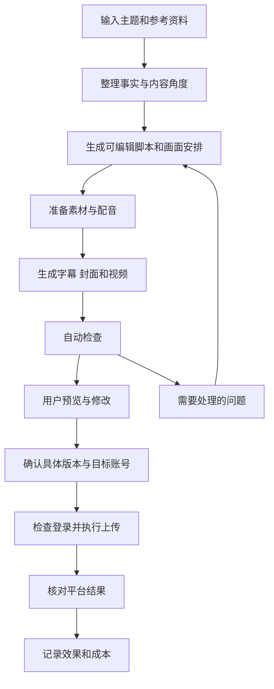
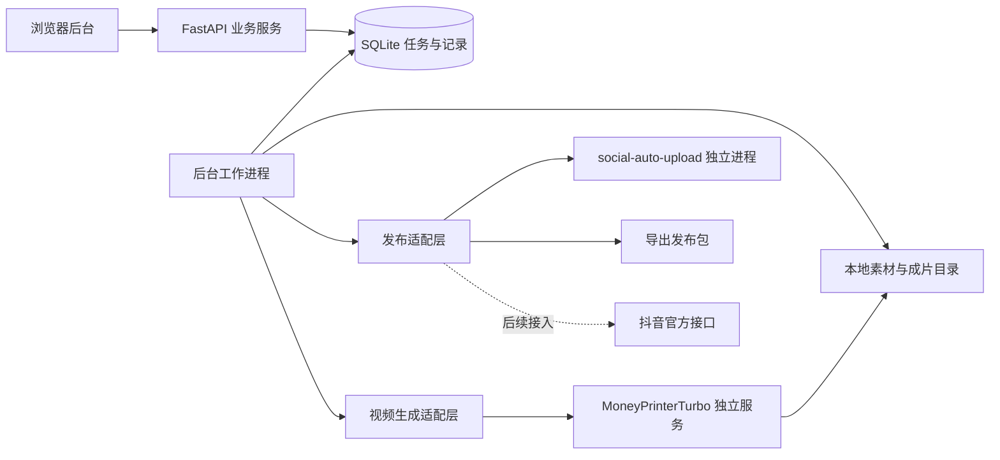

# AI 短视频制作与发布实施方案

版本：第一版方案  
更新日期：2026 年 10 月 14 日  
项目阶段：方案设计，尚未完成集成验证

本项目面向希望持续运营抖音账号的个人创作者。目标是把选题、资料整理、脚本、配音、剪辑、预览、发布和效果记录接成一条可重复运行的流程，减少反复切换工具和手动搬运文件的工作。

第一版采用 **MoneyPrinterTurbo 生成视频、social-auto-upload 作为发布组件候选、本项目提供统一后台与任务调度** 的组合。优先支持一个抖音账号，使用云端模型和配音、本地 CPU 合成视频，成片由用户确认后发布。

现成组件提供部分基础能力；热点筛选、素材质量、任务恢复、发布去重和效果分析需要本项目补充。第一阶段通过样片和集成验证决定是否保留这些组件，不把文档中的功能描述视为本项目已经实现的功能。

## 阅读导航

- [一 项目目标与第一版范围](#一-项目目标与第一版范围)
- [二 一条视频如何完成](#二-一条视频如何完成)
- [三 现成项目与本项目的分工](#三-现成项目与本项目的分工)
- [四 页面与操作设计](#四-页面与操作设计)
- [五 内容生产设计](#五-内容生产设计)
- [六 发布与任务可靠性](#六-发布与任务可靠性)
- [七 技术架构与数据设计](#七-技术架构与数据设计)
- [八 无 GPU 部署方案](#八-无-gpu-部署方案)
- [九 费用与预算控制](#九-费用与预算控制)
- [十 效果记录与变现验证](#十-效果记录与变现验证)
- [十一 开发阶段与验收标准](#十一-开发阶段与验收标准)
- [十二 第一版交付清单与待验证事项](#十二-第一版交付清单与待验证事项)
- [十三 参考资料](#十三-参考资料)

## 一 项目目标与第一版范围

### 1.1 用户最终得到什么

打开一个浏览器后台，输入主题和参考资料，就能生成一条带配音、字幕、封面和标题的视频。用户预览、修改并确认后，系统执行上传，记录发布结果和制作成本。

基础流程稳定后，再增加自动收集选题和历史数据分析。长期目标是让系统根据固定账号方向持续提供候选内容，由用户决定哪些内容值得发布。

技术验收关注视频是否可用、流程能否恢复、发布是否准确。运营验证关注观看、关注和实际收入，两者分别衡量；工具运行成功并不代表账号一定能盈利。

### 1.2 第一版默认配置

以下是实施起点，可在样片验证后调整。

| 项目 | 初始选择 | 原因 |
| --- | --- | --- |
| 平台 | 抖音 | 与当前运营方向一致 |
| 账号 | 一个账号 | 先验证完整流程 |
| 视频形式 | 中文竖屏讲解 | 便于结合配音、字幕和演示素材 |
| 视频时长 | 目标 30～60 秒 | 控制初期脚本和制作复杂度，按实际配音时长调整 |
| 素材 | 自有录屏、图片、视频及许可明确的素材 | 便于解释内容并追溯来源 |
| 运行方式 | 本地电脑，无独立 GPU 要求 | 优先使用现有设备 |
| 发布方式 | 用户确认后执行 | 用户检查成片、文案和目标账号 |
| 制作并发 | 同时合成一条视频 | 控制 CPU 和内存占用 |
| 账号方向 | 可配置 | “实用数码与 AI 工具”仅作为示例，不写死在程序中 |

### 1.3 功能分期

| 功能 | 第一版 | 后续扩展 |
| --- | --- | --- |
| 选题 | 手动输入主题和参考资料 | 指定来源自动收集、筛选和去重 |
| 脚本 | 生成、编辑、保存版本 | 多种表达风格和内容实验 |
| 素材 | 本地上传，接入已验证的素材来源 | AI 生图、生视频和更丰富的素材库 |
| 制作 | 配音、字幕、竖屏合成、简单封面模板 | 多模板、复杂转场、更多尺寸 |
| 预览 | 看成片，修改后重新生成 | 逐段编辑和复用中间结果 |
| 发布 | 导出发布包，集成验证通过后支持抖音上传 | 官方接口、其他平台与多账号 |
| 稳定性 | 状态保存、有限重试、发布去重 | 多工作进程与分布式执行 |
| 数据 | 手动录入或导入可获得的数据 | 有权限后自动读取平台数据 |
| 费用 | 记录用量和费用，设置限额 | 多供应商成本比较 |

第一版不依赖自动获取抖音热榜，也不把自动挂商品、直播、自动回复评论或全无人值守运营列为交付条件。这些能力需要单独确定产品范围和平台接入条件。

## 二 一条视频如何完成

### 2.1 完整流程



热点收集是流程前端的可选输入。无论主题来自用户还是自动收集，都进入同一套资料、脚本和制作流程。

### 2.2 示例任务

用户输入：“介绍一个把会议录音整理成纪要的工具，重点展示使用方法和限制。”同时提供产品说明和一次真实操作录屏。

| 阶段 | 系统执行 | 交付给下一阶段的结果 |
| --- | --- | --- |
| 整理资料 | 提取功能、适用场景、限制和来源 | 可引用事实与待确认问题 |
| 编写脚本 | 组织开头、演示、结果和限制 | 分段文案、建议画面 |
| 检查素材 | 将每段文案对应到录屏或图片 | 素材清单、缺失项 |
| 配音合成 | 生成声音，按实际时长安排画面 | 配音、字幕、预览视频 |
| 检查成片 | 检查能否解码、音轨、时长和字幕边界 | 检查结果 |
| 用户确认 | 展示视频、标题、封面和账号 | 对具体版本的确认记录 |
| 上传发布 | 检查登录，上传，核对平台状态 | 发布结果、作品标识或待核对记录 |
| 记录效果 | 关联后续数据 | 同一条视频的效果历史 |

如果某段缺少操作录屏，系统提示补充或改成图片讲解。没有真实演示结果时，不把“官方声称支持”改写为“我们实测证明”。

### 2.3 日常使用节奏

试运行可按每天制作和发布 1～2 条安排，这是用于观察质量与成本的初始配置，不是推荐算法要求。

用户打开首页后，优先处理三类事情：确认成片、补充缺失资料或素材、恢复过期登录。其他制作步骤在后台运行。用户随时可以暂停新任务，已完成文件和记录继续保留。

## 三 现成项目与本项目的分工

### 3.1 MoneyPrinterTurbo

承担视频制作能力。其上游文档列出主题生成文案、配音、素材匹配、字幕、背景音乐和视频合成，并提供 WebUI、API 或 CLI 等入口。自定义脚本和本地素材可用于控制输出内容。[项目文档](https://github.com/harry0703/MoneyPrinterTurbo)

本项目优先通过 API 调用，具体请求字段、查询方式和输出位置在锁定版本后确定。脚本由本项目确认后传入，避免视频组件再次改写造成内容不一致。

封面模板、精确分镜控制和分段重新生成按实际接口能力评估；缺少的能力由本项目补充，不能默认上游已经提供。

### 3.2 social-auto-upload

承担发布执行候选。上游提供抖音登录、账号检查、视频上传等命令行操作。其发布主要依赖浏览器自动化，当前重构主线偏向 CLI，网页端不保证可直接运行。[项目文档](https://github.com/dreammis/social-auto-upload)

本项目调用独立运行环境中的 CLI，并将返回结果转换成统一的任务状态。标题、简介、封面、话题和排期是否都能按预期设置，要对选定版本逐项测试；不支持的字段必须在界面提示，不能悄悄忽略。

### 3.3 本项目开发内容

| 模块 | 为什么需要 |
| --- | --- |
| 账号内容配置 | 保持受众、表达和视频风格一致 |
| 选题与资料管理 | 保存来源、减少重复、发现信息缺口 |
| 统一工作台 | 在一个地方编辑脚本、素材和成片 |
| 任务调度 | 决定什么时候调用哪个组件 |
| 版本与确认记录 | 保证发布的是用户实际看过的内容 |
| 发布适配层 | 统一处理 CLI、官方 API 和手动导出 |
| 故障恢复 | 从失败阶段继续，减少重复制作 |
| 用量与费用记录 | 判断每条可用视频的真实成本 |
| 效果记录 | 比较内容类型并指导后续选题 |

“适配层”指一小段负责转换参数和结果的程序。上游接口变化时，优先修改这一层，避免影响整个后台。

## 四 页面与操作设计

| 页面 | 展示内容 | 主要操作 |
| --- | --- | --- |
| 首页 | 待处理任务、成片数量、发布状态、今日费用 | 新建任务、暂停队列、进入异常任务 |
| 选题库 | 主题、资料来源、推荐理由、重复情况 | 新增、编辑、选用、归档 |
| 视频工作台 | 脚本、分段画面、素材、配音、成片预览 | 修改、替换素材、生成、重新生成 |
| 发布队列 | 账号、确认版本、计划时间、上传与审核状态 | 确认发布、取消排期、核对结果 |
| 效果看板 | 观看、互动、成本、可获得的收入数据 | 录入、导入、比较同类视频 |
| 设置 | 内容方向、模型、配音、模板、账号、预算 | 保存配置、检查服务和登录 |

初版界面优先显示业务状态，例如“缺少第二段录屏”“视频等待确认”“账号需要重新登录”。详细日志放在展开区域，供排查问题使用。

预览页面同时显示目标账号、视频、封面、标题、简介和话题。发布按钮针对这一整套内容生效，避免分散操作造成版本混淆。

## 五 内容生产设计

### 5.1 账号方向配置

每个账号保存以下配置：目标观众、主要主题、表达方式、默认时长、固定声音、字幕样式、封面模板和避免使用的表述。

例如，“面向普通上班族讲解 AI 工具”意味着脚本优先说明能解决什么问题、怎么操作、有哪些限制。热门事件只有与这些观众相关时才进入候选队列。

### 5.2 热点收集与选题筛选

后续按来源逐步接入官方公告、RSS、可用且有授权的数据接口，以及用户手动添加的链接。每个来源配置更新频率、最近成功时间和失败处理方式。

采集后统一处理标题、URL、原始发布时间、抓取时间和正文摘要。先根据 URL 与规范化标题去重，再检测同一事件的近似内容；语义相似度只作为辅助，不能自动删除所有相似选题。

选题排序考虑以下因素：

| 因素 | 判断问题 |
| --- | --- |
| 受众相关性 | 目标观众会关心吗？ |
| 时效性 | 现在讲还有价值吗？ |
| 资料可靠性 | 主要事实有没有来源支持？ |
| 素材可得性 | 能否给出可理解的演示画面？ |
| 内容差异 | 能提供什么解释、演示或比较？ |
| 历史重复 | 是否刚刚讲过相同内容？ |
| 商业关联 | 是否与未来商品或服务自然相关？ |

系统显示推荐理由和缺失信息。评分用于排序，不标成预计播放量或爆款概率。

### 5.3 事实与脚本

每个关键事实关联来源链接和时间。遇到冲突、过期价格、未经证实的效果或资料不足时，标记待处理。模型辅助检查表达和逻辑，人工检查主要事实与演示结果。

脚本按段保存口播内容、画面要求和引用来源。先生成脚本，再制作配音与视频，便于在消耗渲染资源之前发现问题。

资料中的文字属于待处理内容，不得作为调度指令执行。外部网页不能指示系统改变账号、读取密钥或触发发布。

### 5.4 素材与画面

优先使用实际录屏和自有素材，再使用许可明确、与文案相符的素材。素材记录来源和使用条件，便于后续替换或追溯。

第一版支持上传素材、查看缩略图、指定使用片段和替换素材。若上游不能准确按分镜拼接，需要在适配层或独立合成步骤实现，纳入样片验证。

对于软件教程，通用素材不能代替具体操作步骤。缺少必要画面时，应补录或调整脚本。

### 5.5 配音 字幕与成片

选定一种在线中文配音方案，固定声音和基本语速。根据实际音频长度调整画面，尽量通过修改脚本解决超时，避免任意加速导致难以听懂。

默认采用上游的 `edge` 字幕方式，使用配音时间戳生成字幕。特殊名称、数字、英文缩写进入人工检查重点。背景音乐降低音量，保证人声清楚。最终目标格式为 9:16 竖屏视频，具体编码与大小按发布适配结果确定。

### 5.6 自动检查与人工检查

| 检查方式 | 检查项 |
| --- | --- |
| 自动检查 | 文件存在、可解码、分辨率、时长、音轨、字幕时间范围 |
| 自动检查 | 音频静默、疑似长时间黑屏、素材缺失、字幕溢出风险 |
| 人工检查 | 事实准确、讲解清楚、画面相关、读音自然、封面标题与内容一致 |

黑屏和静默检查允许人工判定合理片段，避免把正常转场当作错误。技术检查通过后仍需预览成片。

## 六 发布与任务可靠性

### 6.1 发布路径

| 路径 | 适用阶段 | 行为 |
| --- | --- | --- |
| 导出发布包 | 从第一版开始可用 | 输出视频、封面、标题和简介，由用户上传 |
| 浏览器自动化 | social-auto-upload 集成验证通过后 | 检查登录，设置支持的字段，上传并核对结果 |
| 官方接口 | 取得相应权限后 | 按平台接口要求授权、创建内容、查询可用状态 |

抖音官方 `video.create` 接口要求申请权限、用户授权，并要求用户明确感知每次代发布操作。接入时根据具体接口规范设计交互。[官方创建视频文档](https://open.douyin.com/platform/resource/docs/openapi/video-management/douyin/create/create-video)

浏览器自动化遇到登录失效、验证码或异常页面时暂停，用户处理后继续。不能以无限重试代替恢复登录。

### 6.2 内容版本与确认

确认记录绑定视频文件摘要、脚本版本、封面、标题、简介、话题、目标账号以及适用的发布时间。摘要用于识别文件内容是否变化。

确认后修改任意将要发布的内容、目标账号或发布时间，原确认失效，回到待确认状态。排期任务执行前再次检查版本、账号和确认记录。

### 6.3 状态设计

制作和发布分别保存状态，避免“视频已完成”与“平台已发布”混为一谈。

| 制作状态 | 含义 |
| --- | --- |
| 草稿 | 主题或资料尚在编辑 |
| 待处理 | 缺少资料、素材或预算，需要用户处理 |
| 排队中 | 等待后台执行 |
| 制作中 | 正在编写、配音或渲染，另存当前步骤 |
| 待确认 | 成片和发布文案已准备好 |
| 制作失败 | 某一步失败，可查看原因并重试 |
| 已取消 | 用户取消该任务 |

| 发布状态 | 含义 |
| --- | --- |
| 未提交 | 尚未创建发布请求 |
| 已排期 | 已确认，等待计划时间 |
| 发布中 | 正在检查登录、上传或提交 |
| 待审核 | 有证据表明已提交，平台仍在审核 |
| 已发布 | 已取得作品标识或其他可核对的发布证据 |
| 发布失败 | 已确认本次提交未成功或平台拒绝 |
| 待核对 | 请求超时或结果不明，需要核对远端状态 |

平台接口或页面只能证明“已提交”时，只记录待审核。无法查询审核状态时保留该状态，允许用户补充确认，不推测为已发布。

### 6.4 去重与故障恢复

每个发布请求使用唯一请求编号，同一个请求只能有一个执行者。数据库记录提交时间、内容版本、账号、执行尝试和远端结果。

同账号和同一成片摘要的重复提交默认拦截；确需重新发布时创建明确的新请求。外部平台未必提供幂等能力，因此本地去重不能保证远端绝对只执行一次，超时后必须先核对再决定重试。

| 故障 | 恢复方式 |
| --- | --- |
| 文案或配音服务暂时失败 | 有限次数重试，记录费用和原因 |
| 素材下载失败 | 更换来源或等待补充 |
| 合成失败 | 复用脚本、素材和已完成配音，重新合成 |
| 登录过期 | 暂停发布，提示重新登录 |
| 上传或提交超时 | 标记待核对，查询远端或人工核对后再操作 |
| 程序在发布中退出 | 重启后转入核对流程，禁止直接重发 |
| 电脑关机错过排期 | 标记错过排期，等待重新确认时间 |
| 预算不足 | 暂停新的付费步骤，保留已有结果 |

本地时间统一使用 `Asia/Shanghai` 展示，数据库时间采用统一时区记录。取消任务后不再进入后续阶段；已经提交到平台的内容不能靠本地取消撤回，需要单独处理。

## 七 技术架构与数据设计

### 7.1 单机架构



“后台工作进程”是持续取出排队任务并执行的程序。网页请求只创建任务和查询状态，长时间视频合成放在工作进程中执行，关闭网页不会取消已保存的任务。

第一版可采用 SQLite 持久化任务表和一个工作进程，不必先部署复杂的消息队列。通过数据库事务领取任务，保存心跳和执行阶段；异常退出后按步骤判断恢复方式。出现多机或高并发需求后再评估 PostgreSQL 和专用队列。

### 7.2 组件隔离与接口约定

两个上游组件各自使用独立虚拟环境或容器，锁定具体版本。本项目保存版本信息，通过适配层转换请求和结果。

视频生成适配层需要提供以下能力：提交生成任务、查询进度、读取输出、返回可理解的错误。发布适配层需要提供：检查账号、提交内容、返回执行证据、核对结果，以及导出发布包。

这些是本项目的接口设计目标，不代表上游存在同名接口。上游不提供的能力需要通过补充代码实现，或在用户界面明确保留人工步骤。

调用 CLI 时使用参数数组，不把标题、简介或模型输出拼进 Shell 命令。为调用设置超时，保存脱敏日志，错误分类为可重试、需用户处理和结果待核对。

### 7.3 核心数据

| 数据对象 | 主要字段 | 用途 |
| --- | --- | --- |
| 账号配置 | 平台、账号标识、受众、主题、模板、声音 | 维持固定风格并确定发布目标 |
| 选题 | 标题、来源、原始时间、推荐理由、去重标识 | 管理选题池 |
| 资料 | URL、获取时间、事实摘要、待确认事项 | 追溯内容依据 |
| 脚本版本 | 分段文案、画面要求、资料引用、版本号 | 编辑和回溯 |
| 素材 | 路径、来源、使用条件、时长、摘要 | 素材匹配和复用 |
| 任务 | 当前阶段、状态、错误、重试次数、时间 | 调度和恢复 |
| 成片版本 | 视频、字幕、封面、生成参数、文件摘要 | 确认和发布 |
| 发布记录 | 请求编号、账号、确认版本、远端标识、证据 | 发布去重和核对 |
| 费用记录 | 服务、用量、费用、估算标记、任务编号 | 预算管理 |
| 效果快照 | 采样时间、指标、来源、视频关联 | 比较不同观察窗口 |

### 7.4 建议目录结构

以下为后续实现建议，目前仅文档目录已建立。

```text
ai-auto-video/
├── README.md
├── docs/
│   └── implementation-plan.md
├── backend/             # 业务服务、数据模型和任务调度
├── frontend/            # 管理界面
├── adapters/            # 视频与发布组件适配
├── templates/           # 提示词、字幕、封面模板
├── scripts/             # 启动、检查、备份工具
├── tests/               # 任务恢复和集成行为测试
└── runtime/             # 数据库、素材、成片、日志，不提交到 Git
```

账号登录文件和密钥单独保存，不进入 Git 或普通日志。初期后台绑定本机地址；需要远程访问时再配置身份验证和受控访问。备份任务数据库与必要成片，备份中涉及凭据的部分单独保护。

## 八 无 GPU 部署方案

MoneyPrinterTurbo 上游文档说明 GPU 非必需，列出的最低配置为 4 核 CPU、4GB 内存，推荐内存为 8GB。默认 `edge` 字幕方式不需要 GPU；本地 Whisper 和较重的处理可以利用 GPU 加速。[配置与字幕说明](https://github.com/harry0703/MoneyPrinterTurbo)

本项目组合了后台、生成组件和上传浏览器，建议准备 8～16GB 内存，并在样片阶段测量内存峰值和处理时间。这是组合部署建议，不是已经完成的性能测试结果。

| 环节 | 无 GPU 实现 |
| --- | --- |
| 文案 | 调用云端文本模型 |
| 配音 | 使用在线中文配音服务 |
| 字幕 | 优先使用配音时间戳 |
| 画面 | 录屏、本地素材和许可明确的素材源 |
| 合成 | CPU 执行视频处理 |
| 发布 | 浏览器自动化或后续官方接口 |

部署依次完成：检查操作系统、Python、FFmpeg、字体和可用空间；安装并固定组件版本；配置模型和素材访问；分别验证生成与登录；连接调度服务；测试重启恢复。

初期先使用本地电脑。若改为服务器，需要验证扫码登录、浏览器显示或远程交互方式，以及机器对模型和素材服务的网络访问。定时执行依赖机器在线且不休眠。

样片阶段至少记录每条视频的总耗时、各阶段耗时、内存峰值、磁盘增长、调用费用和失败原因。根据结果再决定是否升级设备。

## 九 费用与预算控制

### 9.1 成本构成

| 成本 | 控制方式 |
| --- | --- |
| 文案模型 | 缓存结果，限制重复改写 |
| 配音 | 脚本基本确定后生成，能复用时复用 |
| 素材 | 优先自有或许可明确的可用素材 |
| AI 图片与视频 | 初期默认关闭，单独预算 |
| 设备运行 | 先使用现有电脑，限制并发 |
| 存储 | 临时文件按保留期清理，保护确认版本和最终成片 |

服务价格和用量方式在选定供应商后记录。没有账单信息时标为估算或未知，不将未知成本显示成零。

### 9.2 预算执行

支持日预算、单任务预算、每日生成数量和自动重试次数上限。付费步骤前预留估算金额，结束后用实际值结算；上一次调用结果不明时保留相关预算占用，核对后再释放。

预算接近上限时暂停新付费步骤。由于供应商可能延迟记账，应用内预算只能控制后续调用；需要严格资金上限时同时使用供应商提供的限额功能。

```text
平均可用成片成本 = 全部制作支出 / 可用成片数量
期间净收入 = 已结算收入 - 制作费用 - 其他运营费用
```

制作支出包含失败、重试和废弃成片的费用。首批样片完成后给出实际成本表，再确定日常产量，不预设“每条几分钱”或固定盈利数字。

## 十 效果记录与变现验证

初期通过手动录入或平台允许的导出文件获取数据。取得适用接口权限后增加自动采集。缺失指标显示不可用，不用零代替。

| 指标 | 观察的问题 |
| --- | --- |
| 播放量 | 是否获得观看机会？ |
| 平均观看时长与完播率 | 内容是否能留住观众？ |
| 点赞 评论 收藏 分享 | 哪类互动比较突出？ |
| 可获得的涨粉指标 | 是否带来持续关注？ |
| 制作耗时与费用 | 能否持续生产？ |
| 商品点击与订单 | 有带货条件时，是否产生购买行为？ |
| 退款与实际结算收入 | 最终收入是多少？ |

比较时使用相近视频长度、内容类别和发布后观察窗口，例如发布后 24 小时与 7 天。无法归属到单条视频的账号增长单独展示，不强行分摊。

普通视频上传与商品挂载是不同能力。商单、带货或软件推广的具体接入需要另行验证账号条件和功能入口，第一版先保留商品或合作备注字段。

试运行可持续约两周，每天发布 1～2 条，主要检验制作质量、稳定性和内容方向。该规模的数据只适合初步观察；调整开头、时长或模板时记录变更，避免把单条偶然高播放当作稳定结论。

## 十一 开发阶段与验收标准

### 阶段一 验证组件

在无 GPU 配置下运行 MoneyPrinterTurbo，用手动脚本和本地素材生成至少三条不同内容的样片。检查中文字体、配音、字幕同步和画面匹配，同时检查 social-auto-upload 的账号登录及目标字段支持情况。

验收：样片可播放、主要表达清楚；有耗时和费用记录；明确组件版本及缺失能力。实际发布测试须针对已确认的内容与账号进行，编写方案本身不触发账号发布。

### 阶段二 跑通最小流程

实现主题输入、脚本编辑、生成任务、预览、确认、导出发布包和通过验证的上传路径。

验收：用户能在统一后台完成一条任务；任务关联到实际输出；发布的是确认版本；上传和公开发布状态分别记录。

### 阶段三 补齐稳定性

增加持久化队列、有限重试、登录失效处理、发布去重、预算限制与重启恢复。

| 验证场景 | 预期结果 |
| --- | --- |
| 连续点击发布两次 | 同一请求只创建一个执行任务 |
| 确认后修改标题或视频 | 旧确认失效，要求重新确认 |
| 生成组件退出 | 保留已完成阶段，显示可理解的错误 |
| 发布中断网 | 标记待核对，不直接重发 |
| 登录过期 | 暂停任务，登录恢复后继续 |
| 程序重启 | 恢复任务记录，发布中任务先核对 |
| 达到预算上限 | 暂停新的付费步骤 |
| 排期时间已错过 | 提示重新选择时间，不集中补发 |

对关键状态转换和重复发布行为编写测试；对文件、配音、字幕和浏览器发布进行必要的集成与人工验证。

### 阶段四 增加自动选题

逐个接入资料来源，增加去重、相关性判断、来源记录和待处理事项。

验收：每个候选选题有来源、时间和推荐理由；同一事件不会大量重复入库；来源失败不影响其他任务；事实不足的内容不会直接进入发布队列。

### 阶段五 增加效果复盘

实现数据录入或导入、成本汇总、同窗口比较和内容建议。

验收：可以追溯每条视频的制作过程、发布结果和数据来源；未知指标明确展示；能比较不同内容类型的表现与成本。

开发周期在阶段一结束后估算。首先确认素材质量、接口兼容和发布可用性，再决定后续工作量。

## 十二 第一版交付清单与待验证事项

### 12.1 交付清单

- 可启动的统一管理后台。
- 无 GPU 的安装、配置与启动说明。
- 单账号内容配置和一套视频模板。
- 主题与资料输入、可编辑脚本、素材上传和成片生成。
- 成片预览、版本确认和发布包导出。
- 通过集成验证的抖音上传路径及结果记录。
- 持久化任务、错误处理、发布去重和基本预算限制。
- 一批样片、测得的耗时与成本记录。
- 使用、备份、登录恢复和常见故障说明。

### 12.2 待验证事项

| 事项 | 验证方式 | 若不满足如何处理 |
| --- | --- | --- |
| 中文配音与字幕质量 | 样片人工检查 | 更换声音、修正术语或更换服务 |
| 画面与脚本匹配 | 使用真实教程素材验证 | 加入指定素材与分镜合成能力 |
| 生成 API 的实际行为 | 固定版本后提交和查询任务 | 在适配层补充能力或换用 CLI |
| 发布字段完整性 | 分别测试标题、简介、封面、话题 | 明确缺失项，保留手动步骤 |
| 上传结果能否核对 | 检查返回值与创作者后台 | 无法确认时保留待核对状态 |
| 登录持续性 | 跨重启验证账号状态 | 增加重新登录入口 |
| 本机资源与耗时 | 测量样片和连续任务 | 降低并发、调整素材或升级设备 |
| 数据来源可用性 | 验证来源访问和字段 | 继续支持手动输入与导入 |
| 第三方组件使用条件 | 实施前查看所选版本的许可证与依赖说明 | 调整集成、交付和分发方式 |

最先执行的工作是固定组件版本、生成样片并验证发布接入。验证通过后围绕这条流程搭建后台，再逐步扩展自动选题和复盘。

## 十三 参考资料

以下链接支持组件与平台能力说明。实施时应记录实际使用的提交版本与接口文档版本；本文中的目录、状态、数据模型和分期属于本项目设计。

- [MoneyPrinterTurbo 项目与配置说明](https://github.com/harry0703/MoneyPrinterTurbo)
- [MoneyPrinterTurbo 配置示例](https://github.com/harry0703/MoneyPrinterTurbo/blob/main/config.example.toml)
- [social-auto-upload 项目与 CLI 说明](https://github.com/dreammis/social-auto-upload)
- [抖音创建视频接口](https://open.douyin.com/platform/resource/docs/openapi/video-management/douyin/create/create-video)
- [抖音开放平台权限说明](https://open.douyin.com/platform/resource/docs/accession-guide/type-and-permission/)
